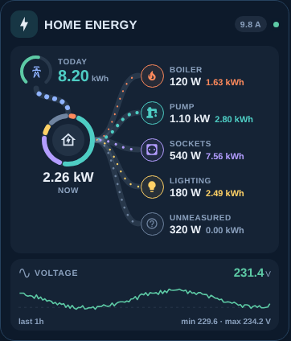
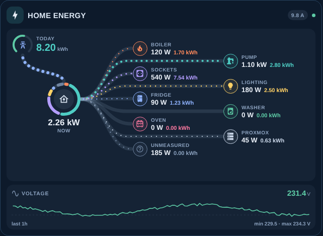
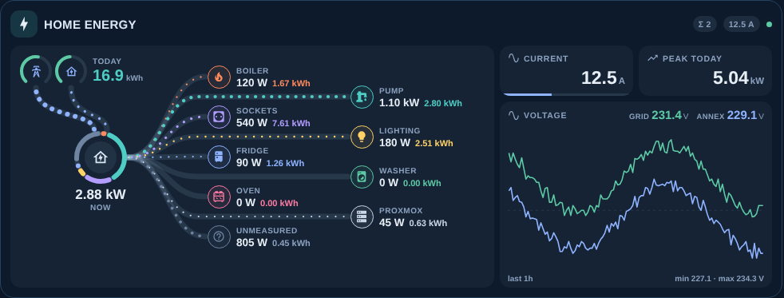

# Energy Flow Card

A compact, responsive Home Assistant Lovelace card for household electricity:
meters with a voltage gauge, **today's kWh computed by the card itself** (no
`utility_meter` or other helpers), consumers with live power and daily energy,
and a voltage history chart. Styled to match the
[EBusD Clas One card](https://github.com/phateks/EBusD-ClasONE-card).

[](https://my.home-assistant.io/redirect/hacs_repository/?owner=phateks&repository=Energy-Flow-card&category=plugin)

<p align="center">
  
  
</p>
<p align="center"></p>

## Features

- **Any number of meters.** Each meter gets a small voltage gauge in the corner,
  green inside the normal band, orange outside. With several meters, totals are
  their sum.
- **Today, from midnight.** The card asks the recorder for today's energy:
  - meter/consumer with an **energy** sensor (`total_increasing`, Wh/kWh/MWh):
    sum of the 5-minute statistic `change` since 00:00 plus the live delta;
  - with only a **power** sensor: the power is integrated over time (5-minute
    statistics, then raw history, then live updates).
  Midnight follows the Home Assistant time zone. Baselines refresh every 5 minutes.
- **Unmeasured** load is shown automatically: meters total − consumers (power and kWh).
- **Adapts to its own width** (phone, tablet, desktop, Sections grid):
  - narrow (< 480 px): one column of consumers; above `max_flow_nodes` the flow
    groups the tail into *Rest* and a full list with *Now / Today* appears below;
  - medium: one column, two staggered columns above 7 nodes;
  - wide (≥ 760 px): flow on the left, *Current*, *Peak today* and the voltage
    chart on the right.
- Animated flows whose speed and thickness follow the power, a ring around the
  house with each consumer's share of the current load.
- Tap anything to open its more-info dialog.
- Dark and light HA themes; visual editor.

## Install

### HACS (recommended)

Click the badge above, or in HACS → ⋮ → **Custom repositories** add
`https://github.com/phateks/Energy-Flow-card` with type **Dashboard**, then
install **Energy Flow Card** and reload the browser.

### Manual

Download `energy-flow-card.js` from the latest release, copy it to
`/config/www/`, and add a dashboard resource:

```yaml
url: /local/energy-flow-card.js
type: module
```

## Configuration

```yaml
type: custom:energy-flow-card
title: Home Energy
meters:
  - name: Grid
    power: sensor.main_meter_power        # W or kW
    voltage: sensor.main_meter_voltage    # V
    energy: sensor.main_meter_energy      # kWh, preferred for "Today"
    current: sensor.main_meter_current    # optional, A
consumers:
  - name: Boiler
    power: sensor.boiler_power
    icon: mdi:fire
  - name: Pump
    power: sensor.well_pump_power
    energy: sensor.well_pump_energy
    icon: mdi:water-pump
  - name: Sockets
    power: sensor.sockets_power
    icon: mdi:power-socket-eu
```

### Card options

| Option | Default | Description |
| --- | --- | --- |
| `title` | `Home Energy` | Card title |
| `icon` | `mdi:lightning-bolt` | Title icon |
| `total_power` | | House total power sensor, read as is (not summed). Takes priority over meters/consumers |
| `total_energy` | | House total energy sensor, preferred for *Today* |
| `meters` | `[]` | Supply-side meters (see below) |
| `consumers` | `[]` | Measured loads (see below) |
| `show_unmeasured` | `true` | Show meters − consumers as its own node |
| `unmeasured_name` | `Unmeasured` | Name of that node |
| `max_flow_nodes` | `6` | Narrow layout: nodes in the flow before grouping into *Rest* |
| `voltage_min` / `voltage_max` | `216` / `244` | Normal voltage band (gauge colour, chart guides) |
| `voltage_hours` | `1` | Voltage chart window, hours |
| `current_max` | `32` | Full scale of the current bar (wide layout), A |
| `idle_threshold` | `5` | Below this many watts a flow is shown as idle |
| `labels` | | Text overrides: `today`, `now`, `voltage`, `current`, `peak_today`, `rest`, `window` (`last {h}`) |

### Meter options

| Option | Description |
| --- | --- |
| `name`, `icon` | Display name / icon (default: entity name, `mdi:transmission-tower`) |
| `power` | Instant power (W/kW). Used for the flow, totals and peak |
| `energy` | Cumulative energy. Preferred source for *Today*; otherwise `power` is integrated |
| `voltage` | Voltage for the gauge and chart |
| `current` | Optional; otherwise power ÷ voltage |

### Consumer options

| Option | Description |
| --- | --- |
| `name`, `icon` | Display name / icon (default: entity name and icon) |
| `color` | Node colour (default: card palette) |
| `power` | Instant power (W/kW) |
| `energy` | Optional cumulative energy for *Today*; otherwise `power` is integrated |

## Notes

- **Where does the total come from?** In order: `total_power` / `total_energy`
  sensors → sum of `meters` → sum of `consumers` (only if nothing else is set).
  A consumer that uses the same sensor as the total or a meter is ignored, so the
  total never appears twice.

- *Today* from a power sensor is as accurate as the sensor's reporting rate.
  An energy sensor from the meter itself is always preferable.
- If a sensor has no statistics (no `state_class`), the card falls back to the
  raw state history for that sensor.
- *Peak today* is the highest 5-minute maximum of the meters' power (or the
  consumers' if there are no meters), updated live.

## License

MIT
